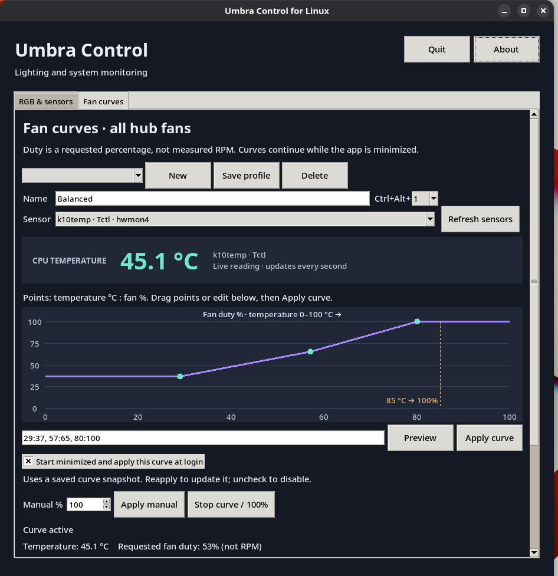
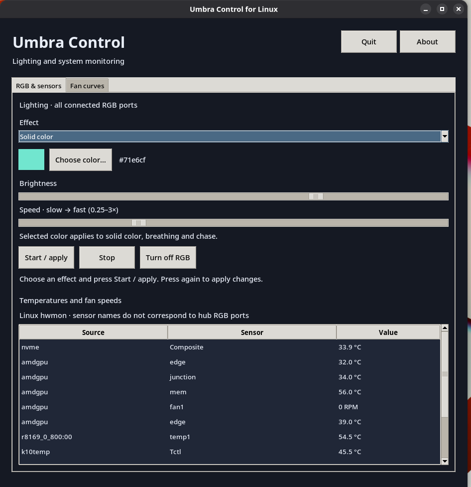
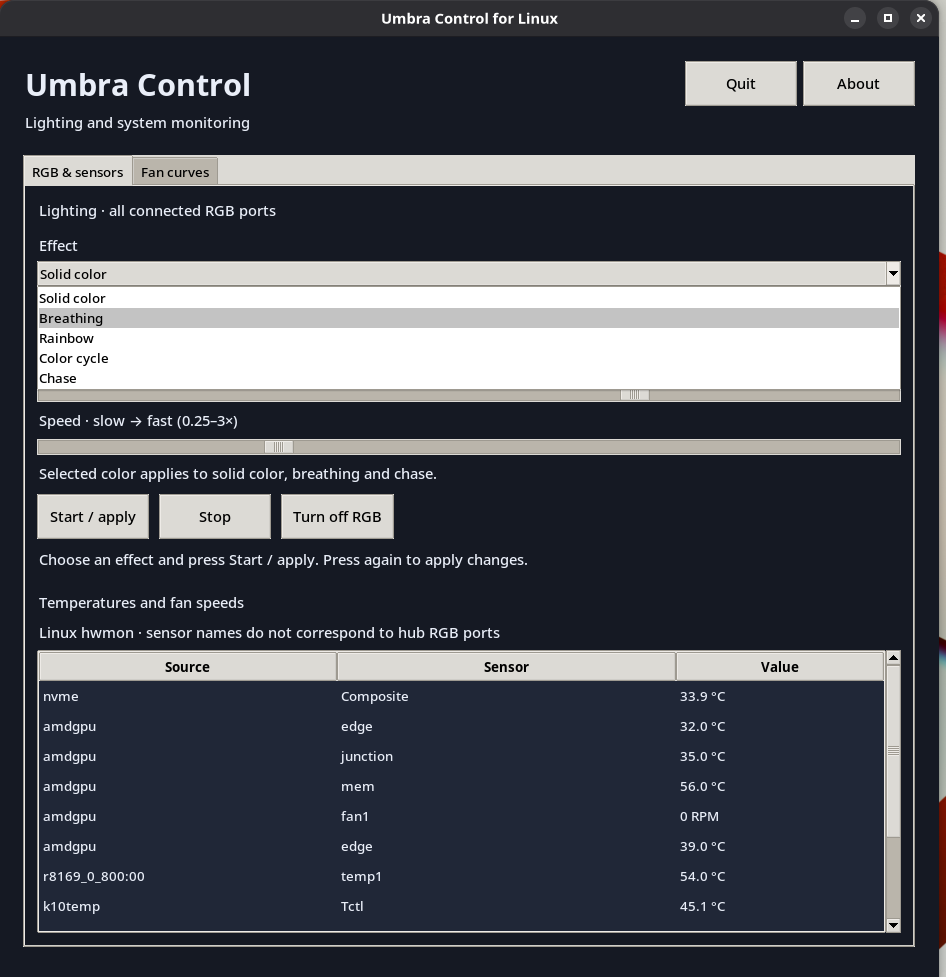
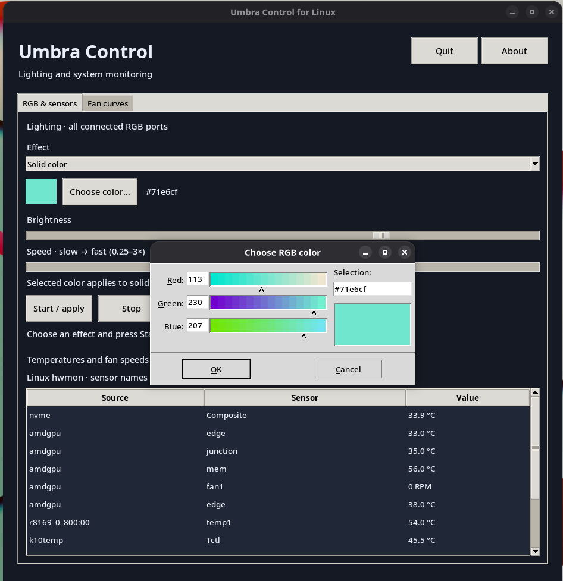

# Umbra Control for Linux

Native Linux desktop control for **AsiaHorse Umbra** RGB lighting and USB fan curves.

**0.4.0 RGB layout preview · Developed by [glassknug](https://github.com/glassknug) · MIT license**

An independent community project, not affiliated with or endorsed by AsiaHorse.

## RGB layout preview

This branch adds an **RGB layout** tab: a PC-case diagram with draggable **fans**, **LED strips** and **Strimer-style ARGB cables**. Individual RGB effects use existing per-port LED addressing; individual motor duty is not implemented.

1. Drag a type from the palette into the PC case, or choose a type and **Add device**.
2. Name the device and assign hub port 1–10 to match its physical wiring. One icon represents a port / LED chain; each port can be placed once.
3. Choose a color, effect, brightness and speed. Use **Update selected device** to commit edits to the diagram.
4. Use **Apply layout RGB** to send the layout. **Unassigned ports turn dark**, and this replaces the running RGB effect. **Stop RGB animation** freezes the last frame; **Turn off ALL RGB** sends black.
5. Use **Save layout** to keep positions and settings in `$XDG_CONFIG_HOME/umbra-control/rgb-layout.json` (default `~/.config/umbra-control/rgb-layout.json`). Apply and Save also commit the selected device's pending edits. Loading a layout does not apply it automatically.

A cable must be compatible with the Umbra ARGB output, including any manufacturer-supported adapter requirements. Selecting an ARGB cable shape does not add support for a separate USB controller. Geometry and positions are illustrations; they are not device detection or an exact LED map of the cable.

The application reads LED counts from the hub when RGB starts. Each port's actual LED count determines its part of the RGB stream. Devices sharing a port share its effect. The existing all-port RGB controls remain available; applying either RGB mode replaces the other. The new tab does not issue fan-duty commands; existing temperature curves continue through the shared USB worker.

After choosing **Quit** in any running copy, test from this extracted branch folder:

```bash
python3 asiahorse_gui.py
```

Automated tests cover RGB stream offsets, independent per-port effects, validation, storage failure recovery and installed-module imports. Desktop visual/dragging checks and hardware validation of the new per-port interface remain pending; this build environment has no display server.

## Demo video

[Watch the Umbra Control demo (MP4, 1:06)](https://github.com/glassknug/umbra-control-linux/releases/download/v0.3.3-preview/umbra-control-demo.mp4)

A real-hardware demonstration of the application and the connected PC lighting. The video is attached to the preview release (approximately 40 MB).

## Features

- Five RGB effects: Solid color, Breathing, Rainbow, Color cycle and Chase.
- Color, brightness and effect-speed controls.
- Editable temperature curves with draggable points and manual fan duty from 30–100%.
- Live CPU temperature display and temperature/requested-duty history graphs.
- Saved profiles with Ctrl+Alt+1–9 shortcuts while the app has focus.
- Background operation: closing the window minimizes it and keeps control running.
- Optional minimized startup with a saved curve after desktop login.
- Application-menu launcher and bundled window icon.

Control applies to all hub fans together. Requested duty is **not measured RPM**.

## Screenshots

### Fan curves



### RGB and sensors



Screenshots of Umbra Control running on Bazzite, including the optional login-startup control.

<details>
<summary>More screenshots: effects and color picker</summary>





</details>

## Installation

Download and extract the complete source archive from this repository, or clone it. Keep its files together.
Python 3 and Tkinter are required; no pip packages are needed.

Install Tk only if it is missing, using the command for your distribution:

```bash
# Bazzite: reboot after installing
sudo rpm-ostree install python3-tkinter

# Fedora Workstation
sudo dnf install python3-tkinter

# Debian / Ubuntu
sudo apt install python3-tk
```

From the extracted project folder, configure USB access once:

```bash
sudo cp 70-asiahorse.rules /etc/udev/rules.d/
sudo udevadm control --reload-rules
sudo udevadm trigger --subsystem-match=hidraw
```

The rule grants access to the active local desktop user. If access is still denied, reconnect the hub's USB connection.

Install the per-user application-menu launcher **without sudo**:

```bash
python3 install_desktop.py
```

Launch **Umbra Control** from your application menu. The installer copies the application into your user data directory; the downloaded folder can then be moved or deleted.

To run directly or inspect an error:

```bash
python3 asiahorse_gui.py
```

Use one app instance and avoid running another controller against the same hub.

## Fan curves

1. Open **Fan curves** and check the selected temperature sensor, for example `k10temp · Tctl`.
2. Drag curve points or enter `temperature:duty` pairs, then choose **Apply curve**.
3. Use **Save profile** to keep a named profile. Optional shortcuts work while the app has focus.
4. To enable login startup, check **Start minimized and apply this curve at login**. This stores a separate curve snapshot. Apply the curve again to update that snapshot; uncheck to disable startup.

The startup option is off by default and runs after desktop login, not during early boot. Ordinary launches do not activate fan control automatically. Only the optional login-startup launch applies the saved startup snapshot.

Closing the window **minimizes** it. Restore it from the taskbar. **Quit** requests 100% duty and exits. **Stop curve / 100%** requests full duty without exiting. Manual control and Stop curve do not remove the saved login-startup curve.

Profile storage: `$XDG_CONFIG_HOME/asiahorse-umbra/profiles.json` (default `~/.config/asiahorse-umbra/profiles.json`). Startup settings and the instance lock use `$XDG_CONFIG_HOME/umbra-control` (default `~/.config/umbra-control`).

## Cooling behavior and limitations

- Missing, invalid or implausible selected-sensor readings request **100% duty**.
- Selected-sensor readings at or above **85 °C** request **100% duty**. This is an application policy, not a universal hardware temperature limit.
- Increases apply immediately; decreases are limited to two percentage points per second. Curve interpolation is linear.
- Manual duty does not follow temperature.
- Normal exit requests 100%; it does not restore the previous firmware curve or motherboard mode.
- Crash, forced termination, suspend or USB loss can interrupt control and leave the last duty latched. A recovery command is not guaranteed.

System temperatures and RPM readings come from Linux hwmon, not decoded hub telemetry. The large CPU display and selected curve sensor are independent; check the sensor selection before applying a curve.

## Hardware validation

Developed and tested with an Umbra hub on **Bazzite Linux**. All five RGB effects and desktop GUI operation have been reported working by glassknug.

USB motor-speed changes were hardware-verified at requested **100% → 75% → 100%**. Lower duty values, other hardware/firmware revisions, combined RGB/curve operation and login startup need further hardware testing. The supported UI range is 30–100%; percentages do not guarantee a particular RPM.

The 0.3.3 package includes the startup dependency missing from 0.3.2. There are **22 passing automated tests**, including loading the startup module from an isolated installed copy. Automated tests do not substitute for desktop and hardware verification.

## USB protocol research

The existing Linux HID driver provides RGB communication with USB device `1a86:fe05` through `/dev/hidraw`.

Analysis of the vendor's UMBRA 3.5.5 Windows software identified the percentage-control command body `FB <percentage>` and ownership switch `08 00/01`. The test above confirmed motor-speed changes using software-control mode `08 01` with duty values `FB 64` and `FB 4B`.

RGB and fan commands share one USB worker. No vendor executable or extracted proprietary program code is included.

See [PROTOCOL.md](PROTOCOL.md) for packet formats and driver quirks.

## Troubleshooting and development

- **Permission denied:** install the included udev rule and reconnect USB.
- **No hub found:** check hub power and its USB data connection.
- **Already running:** restore the existing minimized app from the taskbar.
- **No temperature readings:** check your system's hwmon drivers.
- **Application does not launch:** run `python3 asiahorse_gui.py` from the source folder and include its terminal output in a bug report.

Run tests from the project root:

```bash
python3 -m unittest discover -s tests -v
```

To uninstall, close the app with Quit, then run from a source download:

```bash
python3 install_desktop.py --uninstall
```

This removes the per-user app, launcher and login-startup setting. Saved profiles, system-wide USB rules and Tk remain installed.

## Credits

**[glassknug](https://github.com/glassknug)** — desktop GUI, RGB effects, USB fan-control command analysis and hardware verification, temperature curves, profiles, graphs, shortcuts, sensor display, background operation and desktop integration.

**ToeTagger / LuxDev372** — original Linux HID driver and Linux port. Based in part on [LuxDev372/asiahorse-umbra-linux](https://github.com/LuxDev372/asiahorse-umbra-linux).

**maihcx** — earlier RGB protocol research and [SignalRGB plugin](https://github.com/maihcx/AsiaHorse-Umbra-ARGB-Hub-SignalRGB-Plugin).

**u/idk_a_name_wtf** — original Wireshark capture of passthrough packets.

## License

[MIT](LICENSE). Original copyright and license notices are preserved.
